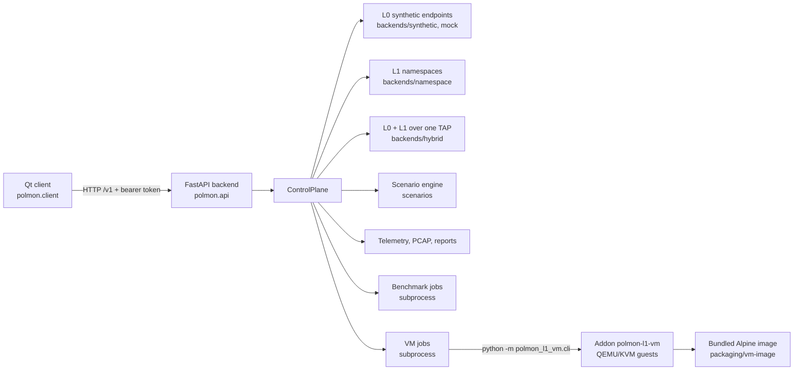

# POLMON overview

POLMON is a resource-efficient platform for controlled network-security experiments in isolated
laboratories, with a FastAPI backend, a Qt desktop client and an optional KVM virtual machine addon.

## Architecture



The backend never imports the addon: it starts the addon's CLI as a subprocess, reads one JSON
document back and keeps one job at a time. In the packaged backend the same CLI is reached
through the `--run-vm` flag.

## Directory tree

```
polmon/
├── src/polmon/            core package
│   ├── api/               HTTP API: routes, control plane, limits, benchmark and VM jobs
│   ├── backends/          L0 synthetic and mock, L1 namespace, hybrid L0/L1
│   ├── benchmarks/        bounded benchmark runner and its CLI
│   ├── client/            PySide6 desktop client (pages, widgets, locales)
│   ├── core/              errors, logging, diagnostics, process lifeline
│   ├── networking/        Ethernet, ARP, IPv4, ICMP frame code
│   ├── orchestration/     deployment lifecycle
│   ├── reporting/         JSON and Markdown experiment reports
│   ├── resources/         admission limits and resource analytics
│   ├── scenarios/         closed-action scenario models, engine, executors
│   ├── telemetry/         SQLite event store and PCAP capture
│   └── topology/          YAML topology models, validation, allocation, CLI
├── addons/l1-vm/          optional package polmon-l1-vm (KVM guests)
├── packaging/             PyInstaller specs; vm-image/ holds the guest image (git-ignored)
├── examples/              topologies, scenarios, VM manifest
├── scripts/               checks, packaging, i18n audit, fetch-vm-image.py, vm-tests.sh
├── tests/                 unit, integration, smoke, performance, gui
└── docs/                  per-topic documentation (start at docs/README.md)
```

## Major modules

| Module | Purpose |
|---|---|
| `polmon/backend.py` | Backend executable: argument parsing, app startup, `--self-test`, `--run-benchmark`, `--run-vm` |
| `polmon/api/control.py` | `ControlPlane`: owns deployments, experiments, benchmarks, VM jobs, telemetry and capabilities |
| `polmon/api/routes.py` | The `/v1` HTTP routes |
| `polmon/api/vm.py` | VM job runner: readiness, image state, one job at a time, cancel, recover |
| `polmon/api/benchmarks.py` | Benchmark job runner |
| `polmon/client/mainwindow.py` | Main window, navigation, connection handling; page list in `PAGES` |
| `polmon/client/pages/` | One module per page (dashboard, topologies, deployment, scenarios, console, packets, telemetry, logs, reports, benchmarks, vm) |
| `polmon/client/locales/` | Russian (default) and English catalogs |
| `polmon_l1_vm/lab.py` | Boots the two-guest lab and tears it down |
| `polmon_l1_vm/host.py` | Host readiness checks |
| `polmon_l1_vm/images.py` | Image verification and clone overlays |
| `polmon_l1_vm/recovery.py` | Journal and cleanup of interrupted runs |
| `polmon_l1_vm/cli.py` | The addon command line |

## Key public pieces

- `ControlPlane(data_directory, ...)` — the backend's state and operations.
- `create_app(control, api_token=...)` — builds the FastAPI application.
- `VMJobs.start(VMRequest)` / `.cancel(job_id)` / `.recover()` — VM job lifecycle.
- `bundled_image()` — where the guest image is looked up.
- `ApiClient` (`polmon/client/api.py`) — the client's only way to talk to a backend.
- `Context.run(...)` — runs a client operation in the background with progress and cancel.

## Entry points

| Command | Runs |
|---|---|
| `polmon-backend` | The backend (`--data-dir`, `--local-l0-only`, `--self-test`) |
| `polmon-client` | The desktop client; it can start a local L0-only backend itself |
| `polmon-topology` | Validate and inspect topologies |
| `polmon-benchmark` | Run benchmarks |
| `polmon-demo` | The target demonstration |
| `polmon-diagnostics` | Host diagnostics |

From a checkout: `.venv/bin/python -m polmon.client` for the GUI. For the VM page, run
`python scripts/fetch-vm-image.py` once; the backend must not run as root.

## Start here

- Read [ARCHITECTURE.md](ARCHITECTURE.md), then [docs/README.md](docs/README.md).
- Gate commands live in `scripts/check.sh`, `scripts/i18n-lint.py` and `scripts/i18n-completeness.py`.
- Every user-facing string goes through the catalogs; the i18n audit fails on hard-coded text.
- Do not run `ruff format` over the whole tree; it is not format-clean and would rewrite unrelated files.
- GUI tests open real windows unless `DISPLAY` is unset; run them with `QT_QPA_PLATFORM=offscreen`.
- The VM `netns` mode is implemented but not verified on real hardware; `userns` is.
